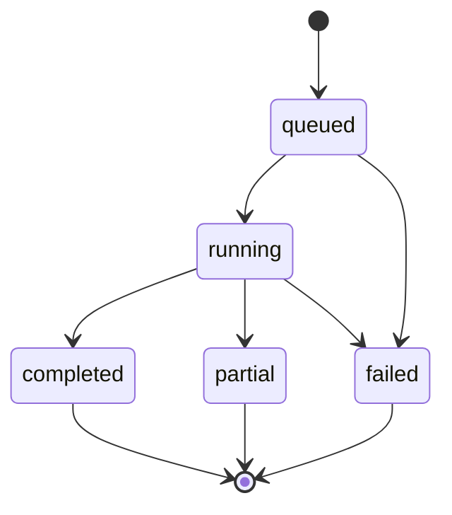

# API «КрасноПарс»

Контракт: [`../openapi.yaml`](../openapi.yaml), OpenAPI 3.1.0. Основание — [`../tz_final.pdf`](../tz_final.pdf), физические страницы 2–9. Сейчас спроектирован API; сервер, коннекторы и поиск ещё не реализованы. Адрес `localhost:8000` — предлагаемый адрес будущего сервера.

## Границы и решения

Один пользовательский режим без регистрации и административной панели, как допускает ТЗ. API обслуживает веб-приложение или расширение. Внешние токены остаются на сервере, в контракт не входят. Отсутствие авторизации рассчитано на локальный прототип; общий публичный сервер потребует отдельного решения о доступе.

| Требование | Контракт | Страница PDF |
|---|---|---|
| Одно поле: тема, событие, человек, новость | `SearchInput.query`; тип запроса определяется внутри поиска | 2–3, 5 |
| Период публикации, Красноярский край | `period`, `region`, `unknown_date_policy` | 3, 8 |
| VK, ОК, MAX; два режима | `platforms`, `scope`; доступность в `/capabilities` | 4–5 |
| Добавление, изменение, удаление источников | `GET/POST /sources`, `GET/PUT/DELETE /sources/{sourceId}` | 4 |
| Поиск по смыслу и изменённым текстам | `Publication.relevance.reason`; правила отбора ниже | 5 |
| Реальные материалы и прямые ссылки | `url`, `retrieved_at`, исходные `title`, `excerpt` | 5 |
| Каждое размещение отдельно, без дублей поста | `placement_key`, `result_count`, `ResultPage.total` | 5 |
| Количество, источник, заголовок, дата, выдержка | `ResultPage`, `Publication` | 6 |
| XLSX совпадает с подборкой | Экспорт по обязательному `snapshot_id` | 6, 8 |
| Поиск идёт, пусто, ошибка; сохранение найденного | `Search.status`, `/coverage`, промежуточные результаты | 6–8 |
| Параметры разных запусков не смешиваются | Отдельный `search_id`, неизменяемый `input` | 7 |

## Последовательность клиента

1. `GET /capabilities` и `GET /sources`: показать площадки, ограничения и доступные источники.
2. При необходимости добавить источник через `POST /sources` или изменить через `PUT /sources/{sourceId}`.
3. `POST /searches` с новым `Idempotency-Key`: получить `202`, `id`, `Location` и `Retry-After`.
4. Опросить `GET /searches/{searchId}` с рекомендованной паузой. Параллельно получать `/coverage` и `/results`, если нужны промежуточные результаты.
5. `/results` без курсора создаёт снимок. Сохранить `snapshot_id`; следующие страницы читать по `next_cursor`. При обновлении выдачи запросить новый снимок и заменить подборку целиком. Число рядом с таблицей брать из `total` этой таблицы, а не из более свежего `Search.result_count`.
6. `POST /searches/{searchId}/exports` с показанным `snapshot_id` и новым `Idempotency-Key`. Опросить `GET /exports/{exportId}` до `completed` или `failed`.
7. Скачать `GET /exports/{exportId}/file`. Экспорт содержит весь снимок, включая страницы, ещё не загруженные клиентом.

Все пути в примерах относительны к `/api/v1`. `400` для синтаксически невалидного JSON и `415` для неподдерживаемого Content-Type должны возвращать тот же `Problem`, что остальные ошибки API. Семантически невалидное тело или параметры — `422`.

## Состояния и частичные сбои

| Состояние | Представление в интерфейсе |
|---|---|
| `queued` | Поиск ожидает запуска |
| `running` | Идёт поиск; ноль пока не означает пустую выдачу |
| `completed`, `total > 0` | Найдено N публикаций; показать ограничения охвата |
| `completed`, `total = 0` | Подходящие публикации не найдены в обработанной области |
| `partial` | Поиск завершён не полностью; найденное доступно, ошибки показаны отдельно |
| `failed` | Поиск выполнить не удалось; показать причину и возможность нового запуска |

`partial` устанавливается, если есть незавершённое покрытие и хотя бы одна успешно обработанная операция либо сохранённая публикация. Поэтому сбой после получения результатов никогда не обнуляет подборку. `failed` означает, что нет ни успешных операций, ни результатов. Терминальное состояние не меняется; поздние ответы внешних систем не меняют завершённый поиск.

`CoverageItem` представляет конкретный источник либо операцию обнаружения на площадке. Для выбранного списка запись создаётся на каждый источник сразу. В широком поиске сначала создаются операции по площадкам, затем добавляются обнаруженные источники. Для недоступной или ненастроенной площадки остаётся видимая запись с причиной. Нельзя молча исключать её из покрытия или подменять отсутствие доступа пустой выдачей.

Успех поиска по доступному индексу не доказывает просмотр всех публикаций платформы. Такие постоянные ограничения указываются в `limitations`. Если не выполнена запланированная операция, например достигнут лимит страниц, она получает `skipped` с `limit_reached`, и поиск завершается как `partial`, если есть успешная работа.

Повтор после ошибки — новый `POST /searches` с прежними параметрами и новым ключом. Старый поиск и его результаты сохраняются, новый выполняется заново. Отдельный endpoint повторной обработки только ошибочных источников для v1 не нужен. Если источник удалён из справочника, для нового запуска его необходимо снова добавить и выбрать; старые снимки продолжают работать.

## Правила данных

- Период включает обе даты в `Asia/Krasnoyarsk`. Сервер сравнивает время публикации, не время загрузки.
- `published_at` допускает RFC 3339 с часовым поясом либо `YYYY-MM-DD`, если источник сообщает только календарную дату, которую можно соотнести с часовым поясом поиска. Время `00:00` вместо неизвестного не подставляется.
- Неизвестная дата передаётся как `null`, в интерфейсе и XLSX — «недоступна». `include_marked` включает такую запись с `period_match=unknown`, `exclude` убирает её. Число таких записей показывается отдельно в `unknown_date_count` и входит в общее количество. Нельзя объявлять их подтверждённо попавшими в период.
- Связь с регионом устанавливается по сохранённой региональной принадлежности источника или содержанию материала. `region_evidence` объясняет конкретное основание. Регион источника, указанный пользователем, является входным признаком, а не автоматически подтверждённым фактом.
- Для широкого поиска `source_ids` запрещён: пользовательский список не ограничивает область. Для выбранных источников он непустой, все ID должны существовать, а их площадки — входить в `platforms`. Если площадка выбрана, но на ней нет выбранных источников, она не проверяется: фактическую область определяет список источников.
- Дедупликация выполняется внутри поиска по идентичности поста. Совпадение текста, embedding или заголовка не является основанием удалить отдельное размещение. URL очищаются от трекинга, а алиасы связываются с ID публикации до подсчёта. Если идентичность установить нельзя, система не должна угадывать её по одному похожему тексту.
- Повторный запуск создаёт отдельную подборку. Идемпотентность защищает от повторной отправки одной операции при сетевом сбое и не объединяет намеренно разные поиски.
- Изменения и удаление источников не переписывают историю: задания хранят их копии. Найденный в широком поиске источник имеет `SourceSnapshot.id=null`, пока не связан с пользовательским справочником.
- Заголовок берётся из публикации, при отсутствии — из начала поста. Выдержка дословная. Объяснение смысловой связи находится отдельно в `relevance.reason`. Если содержание получить нельзя, кандидат не включается как подтверждённый результат; ограничение отражается в покрытии.
- API v1 не удаляет задания, снимки и файлы автоматически. До реализации политики очистки курсоры и снимки не имеют временного срока истечения. Это упрощение для прототипа, объём хранения следует учитывать при реализации.

## Отбор по смыслу

Контракт не привязывает сервер к модели или поставщику. Предполагаемый процесс: получение кандидатов → получение исходного текста и прямой ссылки → нормализация идентичности → проверка периода и региона → смысловой отбор → сохранение размещения.

Для темы достаточно связи содержания с темой; для человека нужна связь именно с указанным человеком и уточнениями. Для исходной новости нужно сопоставлять событие: участников, место, дату, действие и другие различающие факты. Пересказ и сокращение допускаются; сходный текст о другом событии исключается. Один порог сходства слов этого не обеспечивает. Модель может объяснять решение, но ссылки, даты, заголовки и цитаты должны поступать из полученных публикаций.

Проектирование API не подтверждает качество будущего алгоритма. Пропуски, лишние включения и время нужно измерить на размеченных реальных материалах после реализации; в контракт не внесены вымышленные показатели качества.

## Снимок и XLSX

Снимок атомарно фиксирует публикации, их порядок, параметры, состояние и покрытие поиска. Дата без данных не заменяется датой выгрузки. Номер строки в XLSX соответствует позиции во всём снимке, начиная с 1. Ссылки — активные гиперссылки, остальной исходный текст записывается как текст, включая значения, начинающиеся с `=`, `+`, `-`, `@`.

Сбой экспорта не меняет поиск. Можно создать новый экспорт того же снимка с новым ключом. Пустая выдача также экспортируется: заголовки таблицы, параметры и количество 0 остаются в файле. По промежуточному снимку файл содержит явную отметку о незавершённом поиске и не обновляется после завершения задания.

## Проектные допущения

Выбраны REST, опрос состояния, UUID, обязательные ключи идемпотентности, неизменяемые снимки, предел 20 000 символов запроса и 500 выбранных источников. Это решения API, а не дополнительные требования PDF. Импорт Excel, DOCX, тональность, исключение результатов, история всех запусков, отмена, SSE и поиск по новостным сайтам в v1 не включены: в ТЗ они не обязательны.

Следующий шаг реализации — выбрать фактически доступные способы получения данных VK/ОК/MAX. `/capabilities` должен показывать реальные возможности установленного сервера; наличие площадки в enum не означает, что уже реализован её коннектор.
